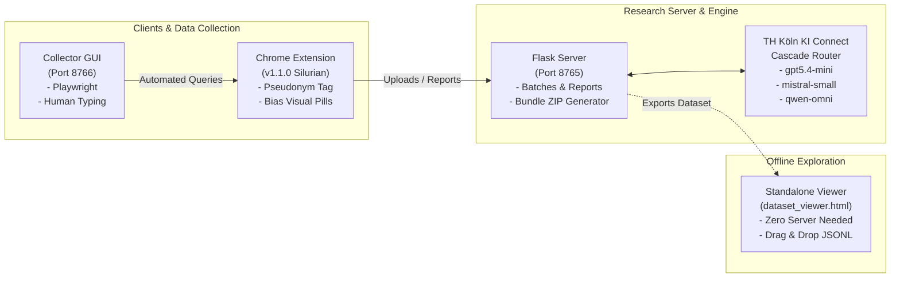

# BrowseBias — Google Autocomplete Bias Research Ecosystem

[](https://github.com/HaakFab/BrowseBias)
[](https://github.com/HaakFab/BrowseBias)
[](LICENSE)
[](https://www.th-koeln.de)
[](https://chat.kiconnect.nrw)

**BrowseBias** is an academic research toolkit and browser audit ecosystem designed to study, quantify, and visually highlight potential bias in Google Search autocomplete suggestions. 

Originally developed as part of research at **TH Köln (University of Applied Sciences)**, it is structured for university coursework, student seminars, and algorithmic auditing studies.

---

## 🏗️ System Architecture



---

## 🌟 Key Features (v1.1.0 Silurian)

- 🏷️ **Pseudonymized User-Tag Auditing**: Automatically assigns privacy-preserving pseudonyms (e.g., `Curious-Fox-42`) to audit how autocomplete varies across user cohorts and search contexts without capturing personal data.
- 🤖 **TH Köln KI Connect Integration**: Uses free, high-performance European AI infrastructure (`chat.kiconnect.nrw`) with an **automated fallback cascade** across top fast models (`openai-gpt5.4-mini`, `mistralai-mistral-small`, `qwen3-omni-30b`, and `openai-gpt-oss-120b`) with a 60-second circuit-breaker cooldown.
- 🖥️ **Cross-Platform Collector GUI**: Non-technical students can run automated data collection on **macOS, Windows, and Linux** with a zero-dependency local web GUI launcher.
- 📂 **Standalone Offline Dataset Viewer**: A single portable HTML file (`viewer/dataset_viewer.html`) that allows students to inspect, search, filter by cohort tag, and export datasets (`.csv`/`.json`) without running a server.
- 📦 **One-Click Dataset Bundling**: The server instantly packages all active datasets (`suggestions.jsonl`, `uploads.jsonl`, `reports.jsonl`, `lexicon.json`) and the offline viewer into a ready-to-use `.zip` bundle.
- 🎨 **Rich Dark-Theme Server Dashboard**: Fluid full-width console with tabular views, all 10 suggestions per row, sorting, column toggles, user-tag filters, and live rating engine controls.

---

## 📁 Repository Structure

```
BrowseBias/
├── plugin/                           # Chrome Extension (Manifest V3)
│   ├── manifest.json                 # Permissions (storage, alarms)
│   ├── icons/                        # Extension icons (16, 48, 128 px)
│   ├── legal/                        # Privacy policy & terms
│   └── src/                          # Content script, background service worker, popup UI
│
├── server/                           # Backend Research API & Dashboard
│   ├── app.py                        # Flask server (Port 8765), bundle packager, web console
│   ├── requirements.txt              # Server dependencies
│   ├── test_server_storage.py        # Integration test suite
│   └── data/                         # Active data directory (git-ignored)
│
├── bias_engine/                      # Bias Identification & Quantification Pipeline
│   ├── llm_providers.py              # THKIProvider & THKICascadeProvider router
│   ├── config.py                     # Provider config & auto-selection
│   ├── default_framework.yaml        # 6-category bias taxonomy & thresholds
│   ├── identification.py             # Multi-category LLM batch classification
│   └── quantification.py             # Listwise ranking & Bradley-Terry fitting
│
├── collector/                        # Playwright User Input Simulator
│   ├── gui.py                        # Cross-platform local web GUI launcher (Port 8766)
│   ├── collector.py                  # Core typing simulator
│   ├── run_collector_gui.command     # macOS one-click launcher
│   ├── run_collector_gui.bat         # Windows one-click launcher
│   ├── run_collector_gui.sh          # Linux one-click launcher
│   ├── keywords.txt                  # General German political topics
│   └── keywords_bundestag.txt        # 736+ Bundestag MP names
│
├── viewer/                           # Offline Analysis Tool
│   └── dataset_viewer.html           # Standalone drag-and-drop HTML dataset viewer
│
├── docs/                             # Depicted Documentation & Guides
│   ├── ARCHITECTURE.md               # Detailed architecture, schemas & dataflow
│   ├── STUDENT_GUIDE.md              # Step-by-step student quickstart
│   ├── INSTRUCTOR_GUIDE.md           # Research setup & THKI configuration
│   └── COLLECTOR_GUIDE.md            # Simulator options & rate limit prevention
│
├── start_collector.py                # Root launcher for Collector GUI
├── README.md                         # Project overview
└── .gitignore                        # Strict rules excluding .env, raw datasets & backups
```

---

## ⚡ Quickstart

### 1. Students & Course Participants
1. **Load Extension**: In Chrome, open `chrome://extensions/`, enable **Developer mode**, and click **Load unpacked** &rarr; select `plugin/`.
2. **Set Pseudonym**: Open the extension popup, check your auto-generated animal pseudonym (e.g. `Curious-Fox-42`), or set your cohort code.
3. **Run Collector GUI**: Run `python start_collector.py` or double-click the launcher for your OS.
4. **Explore Data**: Double-click `viewer/dataset_viewer.html` in your browser and drag & drop `suggestions.jsonl`.
📖 *See [Student Guide](docs/STUDENT_GUIDE.md) for full instructions.*

### 2. Instructors & Researchers
1. **Configure Environment**: Add your TH Köln KI Connect key to `.env`:
   ```bash
   THKI_KEY=your_key_here
   ```
2. **Start Server**:
   ```bash
   pip install flask flask-cors openai
   python server/app.py
   ```
3. Open `http://localhost:8765` to view the server dashboard and trigger the LLM rating engine.
📖 *See [Instructor Guide](docs/INSTRUCTOR_GUIDE.md) for full instructions.*

---

## 📚 Detailed Documentation

- 📐 **[System Architecture & Dataflow](docs/ARCHITECTURE.md)**: Schemas, Mermaid sequence diagrams, circuit-breaker cascade.
- 🎓 **[Student & Course Participant Guide](docs/STUDENT_GUIDE.md)**: Extension install, auditing Google, reporting, offline viewer.
- 👨‍🏫 **[Instructor & Administrator Guide](docs/INSTRUCTOR_GUIDE.md)**: Server setup, THKI models, cohort auditing, bundle exports.
- 🤖 **[Collector Simulator Guide](docs/COLLECTOR_GUIDE.md)**: Playwright setup, typing delays, keyword presets.

---

## 🔒 Privacy & Research Ethics

BrowseBias adheres to strict academic research privacy standards:
- **No Personal Identifiable Information (PII)** is collected or stored.
- **Deterministic/Random Pseudonyms** separate cohort effects without user tracking.
- **Opt-in Data Logging**: Search data logging is explicitly controlled by the user.
- **Zero Third-Party Tracking**: Search recordings are only submitted to the self-hosted research server.
