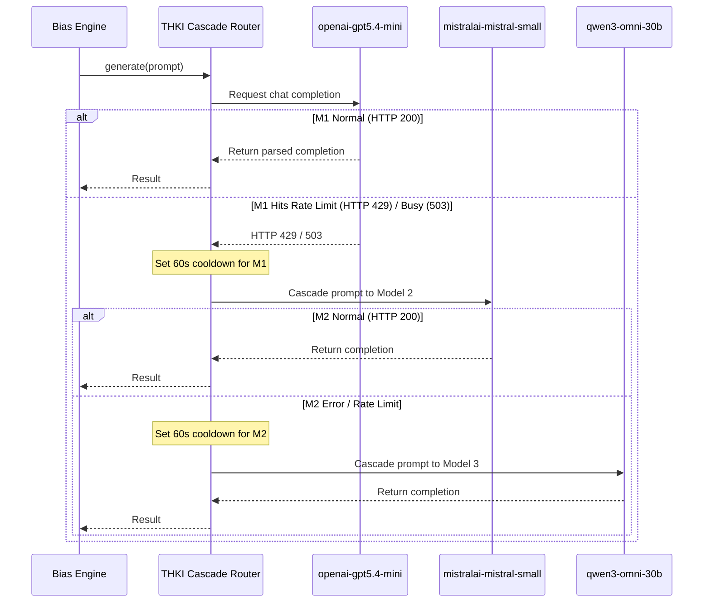
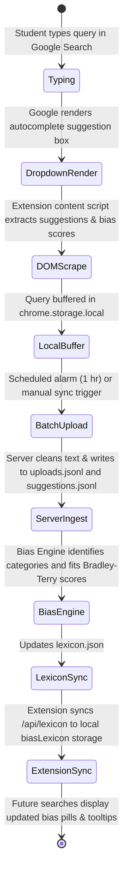

# BrowseBias — System Architecture & Dataflow Specification

**Version:** `1.1.0`  
**Version Tag:** `Silurian`  
**Target Environment:** Academic Course & Research Deployment (TH Köln)

---

## 1. High-Level System Architecture

The **BrowseBias** ecosystem consists of 5 modular components designed to operate seamlessly together or independently:

```mermaid
flowchart TB
    subgraph ClientLayer ["1. Client & Extension Layer"]
        User["Student / Auditor"]
        Ext["Chrome Extension (v1.1.0 Silurian)\n- Pseudonym Generator\n- Bias Visual Pills & Tooltips\n- Local Buffer Storage"]
        Collector["Automated Collector\n- Playwright Browser Simulator\n- Cross-Platform Web GUI (Port 8766)"]
        User -->|Searches Google| Ext
        Collector -->|Automated Human Typing| Ext
    end

    subgraph ServerLayer ["2. Research Server & Ingestion Layer"]
        Server["Flask Research Server (Port 8765)\n- /api/upload (Batches)\n- /api/report (Feedback)\n- /api/lexicon (Synced Cache)\n- /api/download/bundle (ZIP)"]
        Dashboard["Interactive Server Console\n- Fluid Dark Theme Dashboard\n- Cohort / Pseudonym Filtering\n- Live Rating Monitor"]
        Server <--> Dashboard
        Ext -->|POST /api/upload (Hourly/Manual)| Server
        Ext -->|POST /api/report| Server
        Server -->|GET /api/lexicon| Ext
    end

    subgraph StorageLayer ["3. Storage & Dataset Layer"]
        UploadsFile[("uploads.jsonl\n(Raw Batches)")]
        SuggestionsFile[("suggestions.jsonl\n(Flat Queries & Suggestions)")]
        ReportsFile[("reports.jsonl\n(Student Feedback)")]
        LexiconFile[("lexicon.json\n(Quantified Scores & Tooltips)")]
        Server --> UploadsFile
        Server --> SuggestionsFile
        Server --> ReportsFile
        Server <--> LexiconFile
    end

    subgraph OfflineLayer ["4. Offline Analysis & Student Tools"]
        Viewer["Standalone HTML Dataset Viewer\n- Single Portable File\n- Zero Server Needed\n- Drag & Drop JSONL\n- CSV / JSON Exporters"]
        Server -.->|Exports Bundle ZIP| Viewer
    end

    subgraph LLMLayer ["5. Bias Quantification Engine & THKI Cascade"]
        Engine["Bias Engine Pipeline\n1. spaCy Normalization\n2. Multi-Category Identification\n3. Listwise Matchmaking\n4. Bradley-Terry Logistic Fitting"]
        Cascade["TH Köln KI Connect Cascade\n(chat.kiconnect.nrw/api/v1)\nPriority 1: openai-gpt5.4-mini\nPriority 2: mistralai-mistral-small-4-119b\nPriority 3: qwen3-omni-30b-instruct\nPriority 4: openai-gpt-oss-120b"]
        Server <--> Engine
        Engine <--> Cascade
    end
```

---

## 2. Pseudonymized User Tag & Cohort Auditing

To audit whether Google Search autocomplete changes based on user history, cohort location, or search behavior without collecting personal identifiable information (PII):

```
+-------------------------------------------------------------+
|                  Automatic Generation                       |
|   Adjective (24)  +  Animal (24)  +  Number (10..99)        |
|   e.g. "Curious-Fox-42", "Silver-Hawk-88", "Polar-Otter-17"  |
+-------------------------------------------------------------+
                              │
                              ▼
+-------------------------------------------------------------+
|            Plugin Popup Settings (Customizable)             |
|   Students can customize tag to cohort code:                |
|   e.g. "CohortA-Student01", "AuditGroup-DE", "ControlGroup" |
+-------------------------------------------------------------+
                              │
                              ▼
+-------------------------------------------------------------+
|              Data Payload Propagation                       |
|   - Attached to each search item in chrome.storage.local    |
|   - Sent in batch upload payload: user_pseudonym            |
|   - Stored in suggestions.jsonl & reports.jsonl             |
+-------------------------------------------------------------+
                              │
                              ▼
+-------------------------------------------------------------+
|              Dashboard & Viewer Filtering                   |
|   Instructors can filter table rows and compare autocomplete|
|   variance across student cohorts and user tags             |
+-------------------------------------------------------------+
```

---

## 3. TH Köln KI Connect Integration & Smart Rate-Limit Cascade

The bias quantification engine interfaces with **TH Köln KI Connect** (`https://chat.kiconnect.nrw/api/v1`), providing free, high-performance LLM access for students and researchers.

### Selected Fast Models:
1. **Primary (`openai-gpt5.4-mini`)**: Top-tier reasoning and classification quality, ultra-fast latency. Uses `max_completion_tokens`.
2. **First Fallback (`mistralai-mistral-small-4-119b-2603`)**: High-throughput, robust open-weights instruct model.
3. **Second Fallback (`qwen3-omni-30b-a3b-instruct`)**: Ultra-compact, fast instruct model.
4. **Deep Fallback (`openai-gpt-oss-120b`)**: High-parameter open model with reasoning support.

### Cascading & Circuit Breaker Logic:



---

## 4. End-to-End Data Lifecycle



---

## 5. Storage Formats

### `uploads.jsonl` (Batched Submission Records)
```json
{
  "receivedAt": "2026-10-12T10:15:30Z",
  "user_pseudonym": "Curious-Fox-42",
  "version": "1.1.0",
  "v_tag": "Silurian",
  "entryCount": 1,
  "entries": [
    {
      "query": "olaf scholz skandal",
      "googleTld": "www.google.de",
      "language": "de",
      "timestamp": "2026-10-12T10:15:28Z",
      "user_pseudonym": "Curious-Fox-42",
      "suggestions": [
        {"text": "olaf scholz skandal cum ex", "score": 0.85},
        {"text": "olaf scholz vermögen", "score": 0.15}
      ]
    }
  ]
}
```

### `suggestions.jsonl` (Flat Search & Suggestion Pairs)
```json
{
  "timestamp": "2026-10-12T10:15:28Z",
  "receivedAt": "2026-10-12T10:15:30Z",
  "user_pseudonym": "Curious-Fox-42",
  "query": "olaf scholz skandal",
  "suggestion": "olaf scholz skandal cum ex",
  "score": 0.85,
  "googleTld": "www.google.de",
  "language": "de",
  "version": "1.1.0",
  "v_tag": "Silurian"
}
```

### `reports.jsonl` (Feedback & Problematic Suggestions)
```json
{
  "receivedAt": "2026-10-12T10:20:00Z",
  "timestamp": "2026-10-12T10:19:55Z",
  "user_pseudonym": "Curious-Fox-42",
  "reportType": "problematic_suggestions",
  "query": "climate change hoax",
  "suggestions": [{"text": "climate change hoax conspiracy", "score": 0.92}],
  "comment": "Highly speculative and conspiratorial autocomplete suggestion",
  "googleTld": "www.google.com",
  "language": "en-US",
  "version": "1.1.0",
  "v_tag": "Silurian"
}
```
